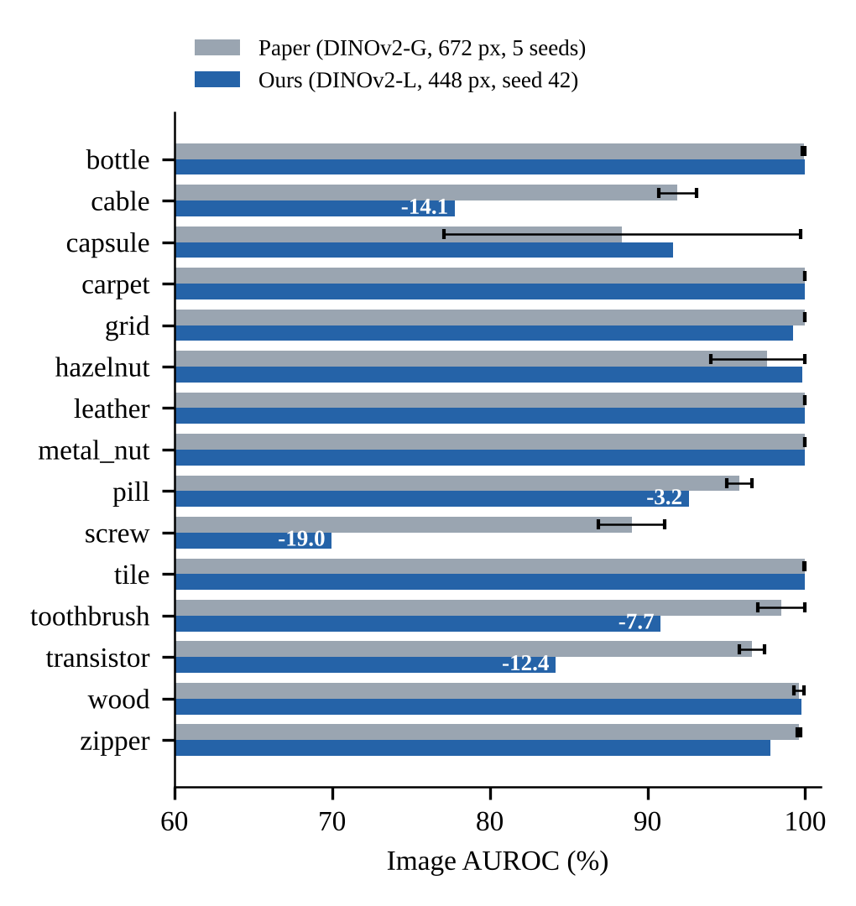
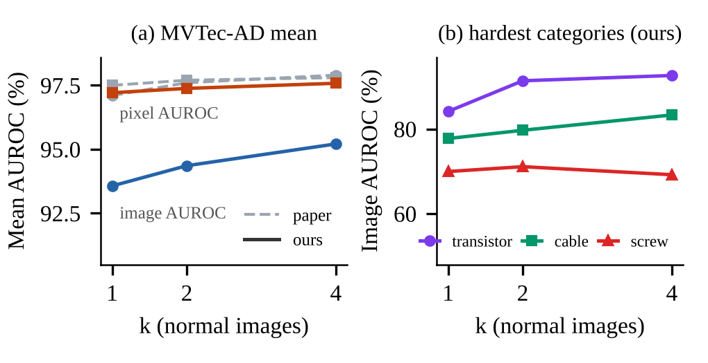
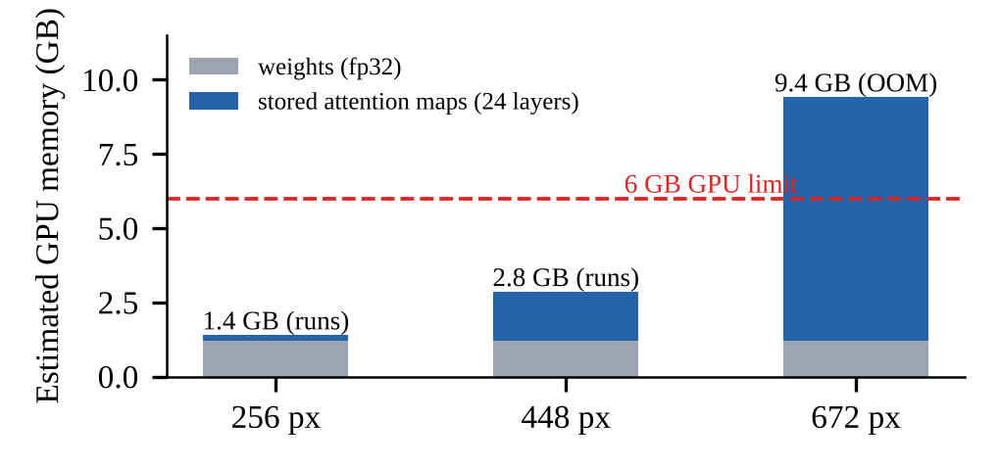

# SubspaceAD: Training-Free Few-Shot Anomaly Detection via Subspace Modeling (CVPR2026)

<p align="center">
  <a href="https://huggingface.co/spaces/MoxVox/SubspaceAD-visual-demo" target="_blank">
    
  </a>
</p>

This repository contains a reproduction study and a Qwen3-VL explanation experiment based on the [official SubspaceAD implementation](https://github.com/CLendering/SubspaceAD).

> [**SubspaceAD: Training-Free Few-Shot Anomaly Detection via Subspace Modeling (CVPR 2026)**](https://openaccess.thecvf.com/content/CVPR2026/html/Lendering_SubspaceAD_Training-Free_Few-Shot_Anomaly_Detection_via_Subspace_Modeling_CVPR_2026_paper.html)

## Reproduction study

This fork reproduces SubspaceAD on **all 15 MVTec AD categories** with the authors' code
on a **6 GB laptop GPU** (NVIDIA Quadro RTX 3000), and adds a grounded vision-language
explanation module. Upstream code is unchanged apart from saving per-image scores and
overlays (commits `59d7d82`, `1e1f9b2`).

**Setup.** The paper uses DINOv2-giant at 672 px. That needs about 25 GB of GPU memory in
this code, so this reproduction uses **DINOv2-registers-large at 448 px**; every other
setting matches the authors' `scripts/benchmark_few_shot.sh` (layers −12…−18 averaged,
30 rotation augmentations, PCA 99% variance, top-1% image score, seed 42).

### Main results (MVTec AD, %)

| | Ours k=1 | Ours k=2 | Ours k=4 | Paper k=1 | Paper k=2 | Paper k=4 |
|---|---|---|---|---|---|---|
| Image AUROC | 93.6 | 94.4 | 95.2 | 97.1 | 97.6 | 97.9 |
| Pixel AUROC | 97.2 | 97.4 | 97.6 | 97.5 | 97.7 | 97.8 |
| AU-PRO | 93.2 | 93.5 | 94.1 | 93.7 | 94.1 | 94.3 |

Paper values: 5-seed means from the paper's supplementary Table 5. Ours: one seed (42).

<p align="center"> </p>

### Key findings

1. **Localisation survives, detection drops.** The smaller backbone at lower resolution
   keeps pixel AUROC within 0.3 points of the paper, but one-shot image AUROC falls by
   3.5 points. Four normal images close about half of that gap.
2. **The gap comes from three categories, each for a different reason.**
   - *Transistor* (84.2 vs 96.6): the code disables augmentation for this category, so
     PCA learns from only 1,024 patches. A second normal image adds +7.3 points.
     Missing or misplaced transistors are logical anomalies that patch-wise scoring misses.
   - *Cable* (77.8 vs 91.9): swapped wires look normal patch by patch; only the
     arrangement is wrong.
   - *Screw* (70.0 vs 89.0): more normal images do **not** help (70.0 → 71.1 → 69.2),
     while the paper's larger, higher-resolution setting scores 19 points more. Tiny
     thread defects are limited by resolution, not by data.
3. **Why the paper setting does not fit small GPUs.** The extractor requests attention
   maps from every layer (`output_attentions=True`, eager attention), so memory grows
   with the square of the token count: about 9.4 GB for DINOv2-large at 672 px (out of
   memory on 6 GB) versus 2.8 GB at 448 px. The estimate matches the allocation in the
   out-of-memory error to within 0.2%.

<p align="center"></p>

4. **The chosen normal image matters.** The seed is drawn once and consumed category by
   category, so running a subset of categories changes the sampled images: screw and
   transistor moved by +1.2 and −2.0 points with no other change. Run all 15 categories
   to reproduce these numbers.
5. **Grounded explanations (Qwen3-VL-2B, local, fp16).** The detector decides and the
   language model only explains. It followed every correct NORMAL decision (11/11), but
   naming the defect type stayed at chance level (19–22% vs 20%). Details:
   [Qwen evaluation](reports/qwen_evaluation_results.md).

### Reproduce

```bash
conda activate subspacead
python -u main.py --dataset_name mvtec_ad --dataset_path datasets/mvtec-ad \
  --image_res 448 --k_shot 1 --layers="-12,-13,-14,-15,-16,-17,-18" \
  --model_ckpt facebook/dinov2-with-registers-large --aug_count 30 \
  --pca_ev 0.99 --seed 42 --agg_method mean --outdir results/repro_k1_mvtec_L448
bash run_kshot.sh          # k = 2 and 4
```
Environment: Python 3.10.22, PyTorch 2.14.1 (CUDA 13.0), Transformers 5.20.1
(full list in `my_versions.txt`). Dataset counts were verified against the official
split (3,629 train / 1,725 test). [Lab notes](LAB_NOTES.md) record every run.

---

<p align="center">  </p>

Figure 1. SubspaceAD consists of two training-free stages: (1) extracting DINOv2 patch features from a few normal exemplars, and (2) estimating a low-dimensional PCA subspace to model normal appearance. Anomalies are detected via reconstruction residuals.

## Introduction

Detecting visual anomalies in industrial inspection often requires operating with only a few normal exemplars per category. While many recent approaches rely on large memory banks, auxiliary datasets, or multi-modal tuning, **SubspaceAD** introduces a minimalist, training-free alternative.

SubspaceAD consists of two stages:

1. **Feature Extraction:** Patch-level features are extracted from a small set of normal images using a frozen **DINOv2** backbone.
2. **Subspace Modeling:** A **PCA** model is fit to these features to estimate the low-dimensional manifold of normal appearance.

At inference time, anomalies are detected using the reconstruction residual with respect to this learned subspace.
Despite its simplicity, SubspaceAD achieves **state-of-the-art** performance in one-shot and few-shot settings.

**Main Results (1-Shot)**

* **MVTec-AD:** 97.1% Image AUROC; 97.5% Pixel AUROC
* **VisA:** 93.4% Image AUROC; 98.2% Pixel AUROC

---

<p align="center">
  <table>
    <tr>
      <td align="center">
        
        <br>
        <sub><b>MVTec-AD</b></sub>
      </td>
      <td align="center">
        
        <br>
        <sub><b>VisA </b></sub>
      </td>
    </tr>
  </table>
</p>

<p align="left"><i>Figure 2. Qualitative comparison on VisA and MVTec-AD (1-shot). SubspaceAD produces sharper and more precise anomaly maps than
PromptAD and AnomalyDINO, with fewer false activations and better alignment with ground-truth defects across both datasets.</i></p>


## Environment Setup

```bash
# 1. Create environment
conda create -n subspacead python=3.10
conda activate subspacead

# 2. Install dependencies and the package
pip install -r requirements.txt
pip install -e .
```

## Data Preparation

### MVTec-AD

Download the dataset from the [MVTec website](https://www.mvtec.com/company/research/datasets/mvtec-ad) and extract it to:

```
datasets/mvtec-ad/
```

### VisA

```bash
# 1. Download and extract
mkdir -p datasets/VisA_20220922
wget https://amazon-visual-anomaly.s3.us-west-2.amazonaws.com/VisA_20220922.tar
tar -xvf VisA_20220922.tar -C datasets/VisA_20220922

# 2. Preprocess (reorganize folder structure)
python tools/prepare_visa.py \
    --data-folder datasets/VisA_20220922 \
    --save-folder datasets/VisA_pytorch
```

## Folder Structure

```text
pca-dino/
├── datasets/                   # Dataset root
│   ├── mvtec-ad/
│   └── VisA_pytorch/
├── logs/                       # Experiment logs
├── scripts/                    # SLURM/Bash benchmark scripts
│   ├── benchmark_few_shot.sh
│   ├── benchmark_full_shot.sh
│   └── ...
├── src/
│   └── subspacead/
│       ├── core/               # PCA + feature extraction code
│       ├── data/               # Dataset loaders & transforms
│       ├── post_process/       # Scoring, pixel maps, filters
│       └── utils/              # Visualization, logging
├── tools/
│   └── prepare_visa.py
├── main.py
└── README.md
```

## Usage

### Benchmark Scripts

Scripts are provided in `scripts/` to reproduce all results.
Edit `MVTEC_PATH` and `VISA_PATH` inside the scripts as needed.

**Few-Shot (1, 2, 4 Shots)**
Selects *k* normal images per category.

```bash
bash scripts/benchmark_few_shot.sh
```

**Batched Zero-Shot**
Fits PCA on the full unlabeled test set.

```bash
bash scripts/benchmark_batched0shot.sh
```

**Full-Shot**
Uses all training images.

```bash
bash scripts/benchmark_full_shot.sh
```

### Manual Execution

Example: 1-shot MVTec-AD on `bottle`:

```bash
python main.py \
    --dataset_name mvtec_ad \
    --dataset_path datasets/mvtec-ad \
    --categories bottle \
    --model_ckpt facebook/dinov2-with-registers-giant \
    --image_res 672 \
    --k_shot 1 \
    --aug_count 30 \
    --pca_ev 0.99 \
    --outdir results/debug_run
```

## Benchmark Results

### Few-Shot (Image AUROC)

| Setting    | Method         | MVTec-AD | VisA     |
| ---------- | -------------- | -------- | -------- |
| **1-Shot** | PromptAD       | 94.2     | 86.9     |
|            | AnomalyDINO    | 96.6     | 87.4     |
|            | **SubspaceAD** | **97.1** | **93.2** |
| **2-Shot** | PromptAD       | 95.7     | 88.3     |
|            | AnomalyDINO    | 96.9     | 89.7     |
|            | **SubspaceAD** | **97.5** | **93.8** |
| **4-Shot** | PromptAD       | 96.6     | 89.1     |
|            | AnomalyDINO    | 97.7     | 92.6     |
|            | **SubspaceAD** | **98.0** | **94.7** |

### Batched Zero-Shot

| Method         | MVTec-AD | VisA     |
| -------------- | -------- | -------- |
| MuSc           | **97.8** | **94.1**     |
| AnomalyDINO    | 94.2     | 90.7     |
| **SubspaceAD** | 96.6     | **94.1** |

## Citation

If you find this repository useful, please consider citing:

```bibtex
@inproceedings{lendering2026subspacead,
  title={SubspaceAD: Training-Free Few-Shot Anomaly Detection via Subspace Modeling},
  author={Lendering, Camile and Akdag, Erkut and Bondarev, Egor},
  booktitle={Proceedings of the IEEE/CVF Conference on Computer Vision and Pattern Recognition (CVPR)},
  pages={28557--28566},
  year={2026}
}
```
